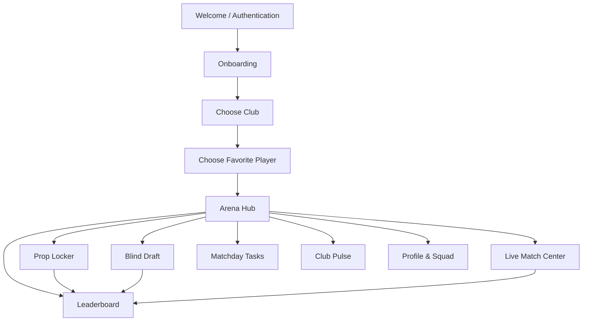
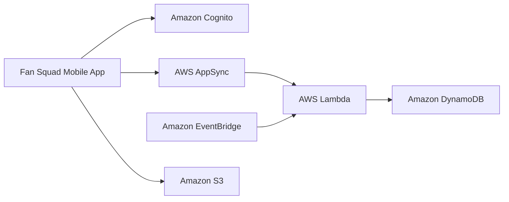

# ⚽ FAN SQUAD

### Your club. Your matchday. Your squad.

**A gamified second-screen companion for football fans — built to make every match more interactive, competitive, and personal.**

[](https://reactnative.dev/)
[](https://www.typescriptlang.org/)
[](https://aws.amazon.com/)
[](https://aws.amazon.com/)

**Fan Squad was developed for the AWS Innovation Cup, where the project reached finalist status.**

---

## 🏟️ What is Fan Squad?

Fan Squad is a football fan-engagement app designed as a **second-screen companion**: while watching a match, fans can make predictions, build a blind-draft squad, follow live match events, compete on leaderboards, complete matchday missions, and react with other supporters.

Instead of giving every fan the same generic experience, Fan Squad adapts its visual identity and selected content to the user's chosen club and favorite player. The current version supports **three Bundesliga clubs** — **FC Bayern München, Borussia Dortmund, and SV Werder Bremen** — with club-specific colors, layouts, and styling.

The project combines a mobile-first interface with a planned AWS backend architecture for authentication, persistent data, and real-time match experiences.

> **Project status:** The mobile frontend is implemented with local Zustand state and mock data. A Python WebSocket emitter is included for replaying DFL XML match events. AWS cloud services are documented as the planned backend architecture and should not be considered fully integrated unless confirmed in the implementation.

## 🏆 AWS Innovation Cup

Fan Squad was built for the **AWS Innovation Cup**, and the project was selected as a **finalist**.

The project explores how cloud architecture and interactive mobile experiences can be combined to improve fan engagement: personal club theming, prediction mechanics, match-event timelines, social banter, and leaderboard competition form one connected matchday experience.

## ✨ What you can do

| Feature | What it does |
|---|---|
| **Club-based onboarding** | Choose Bayern, Dortmund, or Werder Bremen and select a favorite player. |
| **Personalized club theme** | Applies club-specific colors and visual styling across the app based on the user's selection. |
| **Arena Hub** | Provides a central matchday dashboard with match information, stats, and feature navigation. |
| **Prop Locker** | Make match predictions using swipeable binary, slider, and multiple-choice interactions. |
| **Blind Draft** | Draft five players from both teams without seeing their stats first — a test of football instinct. |
| **Live Match Center** | Follow a match timeline, momentum indicator, and squad chat with emote reactions. |
| **Leaderboard** | Compare standings through a podium and ranked list, with the current user highlighted. |
| **Profile & squad** | Personalize a profile, upload an avatar, and view squad details. |
| **Matchday Tasks** | Complete missions to earn lobby points and add another layer of competition. |
| **Club Pulse** | Browse a vertically scrolling football-news feed designed for quick matchday discovery. |

## 🎨 Personalization: one app, three club identities

Fan Squad's theme engine makes the experience feel tailored to the fan instead of simply changing a logo. The selected club is stored in Zustand, and the `useTheme` hook provides the theme values used throughout the app.

| Supported club | Primary color | Theme character |
|---|---|---|
| **FC Bayern München** | `#DC052D` | Bold red-and-white styling with sharper corners |
| **Borussia Dortmund** | `#FDE100` | High-contrast yellow-and-black styling |
| **SV Werder Bremen** | `#1D9053` | Green-and-white styling with rounded controls |
| **Default** | `#00FFC2` | Neutral fallback theme |

The current implementation supports these **three selectable clubs**. The architecture can be extended with additional club data, assets, and theme tokens; additional clubs should not be assumed to be available in the current build.

Personalization currently includes:
- Club-driven colors and component styling
- Favorite-player selection during onboarding
- User profile name and avatar customization
- User-aware highlighting in leaderboard views
- Club and squad information displayed throughout the experience

## 🧭 App experience



## 🧰 Tech stack

| Area | Technology | Role |
|---|---|---|
| Mobile app | React Native | Cross-platform mobile UI |
| Development/runtime | Expo SDK 54 | Local development and app tooling |
| Navigation | Expo Router v6 | File-based routing |
| Language | TypeScript | Typed application code |
| State management | Zustand v5 | Shared local app state |
| Motion & gestures | Reanimated v4, Gesture Handler | Swipe interactions and UI-thread animations |
| User image selection | `expo-image-picker` | Profile avatar selection |
| Haptics | `expo-haptics` | Tactile feedback |
| Match-event prototype | Python, WebSockets | Replays parsed match events to connected clients |
| Event parsing | DFL XML parser | Converts match data into app-consumable events |
| Planned authentication | Amazon Cognito | User identity and authentication |
| Planned API / real-time layer | AWS AppSync | GraphQL API and subscriptions |
| Planned business logic | AWS Lambda | Server-side validation and scoring |
| Planned data store | Amazon DynamoDB | Persistent application data |
| Planned event scheduling | Amazon EventBridge | Event-driven match workflows |
| Planned object storage | Amazon S3 | Avatars and static assets |

### AWS architecture direction

The planned AWS backend is documented in [`Backend_Guide.md`](Backend_Guide.md). At a high level:



This diagram describes the **planned architecture**, not a claim that every AWS service is already connected in the current frontend.

## ⚡ Match-event replay prototype

The repository includes a Python WebSocket emitter that parses DFL XML match data and streams events to clients. It can replay a 90-minute match at **10× speed**, allowing a full match timeline to be explored in approximately nine minutes.

| Message type | Purpose |
|---|---|
| `INIT` | Sends teams, players, and match metadata when a client connects |
| `EVENT` | Sends an individual match event with timing and associated data |
| `COMPLETE` | Signals that the replay has finished |

Supported event categories in the current parser include kickoff, shots, goals, fouls, cards, corners, substitutions, penalties, tackles, and play events used for momentum.

## 📁 Project structure

```text
FAN-SQUAD/
├── README.md
├── Backend_Guide.md
├── QUICK_START.md
├── IMPLEMENTATION_SUMMARY.md
├── backend/
│   ├── emitter.py
│   └── requirements.txt
└── fan-squad/
    ├── app/
    │   ├── index.tsx
    │   ├── onboarding.tsx
    │   ├── _layout.tsx
    │   ├── auth/
    │   └── (app)/
    │       ├── hub.tsx
    │       ├── prop-locker.tsx
    │       ├── draft.tsx
    │       ├── live.tsx
    │       ├── leaderboard.tsx
    │       ├── profile.tsx
    │       ├── tasks.tsx
    │       ├── pulse.tsx
    │       └── squad.tsx
    ├── assets/images/
    ├── components/
    ├── constants/
    ├── hooks/
    ├── services/
    ├── store/
    ├── types/
    └── utils/
```

## 🚀 Getting started

### Requirements

- Node.js 18 or newer
- npm 9 or newer
- Python 3.9 or newer (only for the optional match-event emitter)
- Expo Go on a phone, or an Android/iOS simulator

### 1. Clone the repository

Replace `<repository-url>` with the actual GitHub clone URL:

```bash
git clone <repository-url>
cd FAN-SQUAD/fan-squad
```

### 2. Install dependencies

```bash
npm install --legacy-peer-deps
```

### 3. Start the app

```bash
npx expo start --port 4000
```

Use the Expo terminal shortcuts to open the app:
- Scan the QR code with Expo Go on a physical device
- Press `a` for an Android emulator
- Press `i` for an iOS simulator
- Press `w` to open the web version, if supported by the project's dependencies

### 4. Start the optional WebSocket emitter

From the repository root, install the Python dependency and run the emitter:

```bash
pip install -r backend/requirements.txt
python backend/emitter.py
```

The emitter's availability depends on the match-data files and configuration expected by the backend. Check `Backend_Guide.md` and the source before running it.

## 🧪 Scripts & testing

Run the following commands from the `fan-squad/` directory:

```bash
npm run start
npm run android
npm run ios
npm run web
npm run test
```

For a single Jest run, the existing project documentation lists:

```bash
npx jest --testPathPattern="\.test\.ts" --passWithNoTests
```

Use the commands supported by the current `package.json`; scripts may differ if the project has changed.

## 🧠 Engineering decisions

- **Zustand for shared state:** keeps local state management lightweight and avoids unnecessary provider boilerplate.
- **Local player image assets:** supports fast rendering without requiring a remote image request for every player.
- **Club-driven theme hook:** centralizes theme decisions so screens can respond consistently to the selected club.
- **Expo Router:** keeps navigation organized around the app's file structure.
- **Reanimated and Gesture Handler:** support fluid swipe interactions and animated feedback.
- **Single WebSocket managed by shared state:** helps avoid duplicate connections as users move between screens.

## 🗺️ Roadmap

- [x] Mobile-first experience and core screen flows
- [x] Three selectable Bundesliga club themes
- [x] Local profile and favorite-player customization
- [x] Prediction and blind-draft interaction prototypes
- [x] Python WebSocket match-event replay prototype
- [ ] Connect authentication to Amazon Cognito
- [ ] Replace mock data with persistent backend data
- [ ] Integrate AWS AppSync subscriptions and Lambda workflows
- [ ] Store profile assets using Amazon S3
- [ ] Expand club coverage beyond the current three clubs
- [ ] Connect matchday scoring and leaderboard updates to a backend

## 🔐 Current implementation status

The current app uses local Zustand state and mock data for much of the user experience. AWS services are part of the documented backend plan, and `services/awsStubs.ts` contains integration stubs. Do not treat planned cloud features as production integrations until they are implemented and tested.

For a real-time demo, the Python WebSocket emitter is a separate prototype and should be configured with the relevant DFL XML data. Avoid adding credentials or API keys to source control.

## 🤝 Contributing

Contributions and ideas are welcome. A useful contribution workflow is:

1. Open an issue describing the bug, improvement, or feature.
2. Keep changes scoped and consistent with the existing React Native and TypeScript conventions.
3. Test affected screens and interactions.
4. Submit a pull request with a concise summary and verification notes.

## 📄 License

The previous README lists MIT. Confirm that a corresponding `LICENSE` file exists in the repository before treating the project as formally distributed under that license.

---

**Built for football fans. Designed around your club.**

*Fan Squad — AWS Innovation Cup Finalist*
